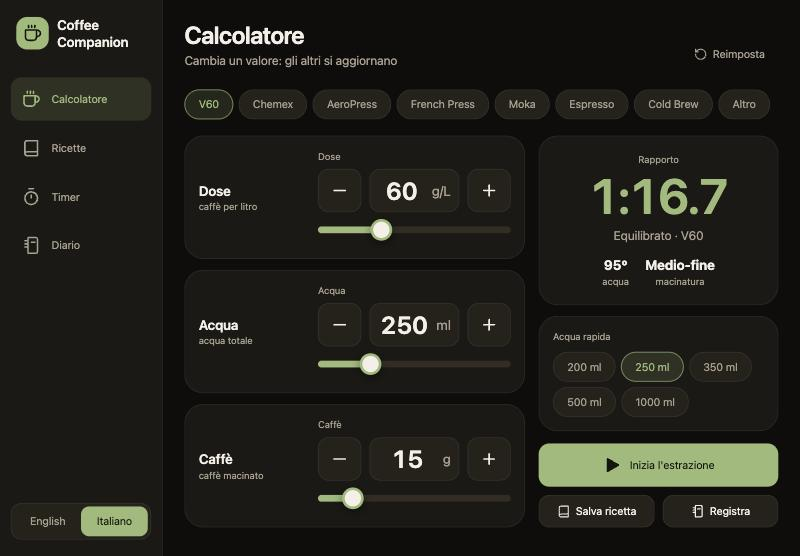
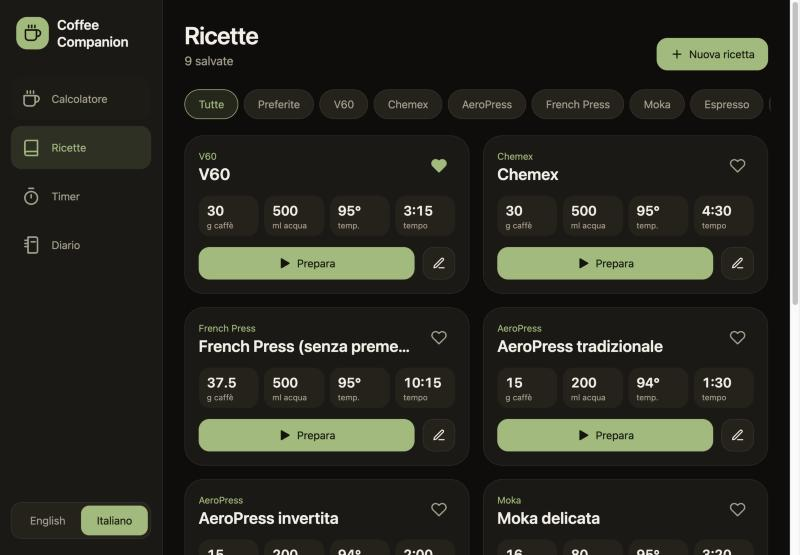
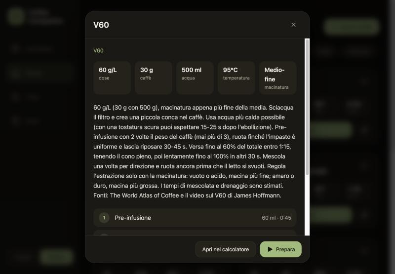
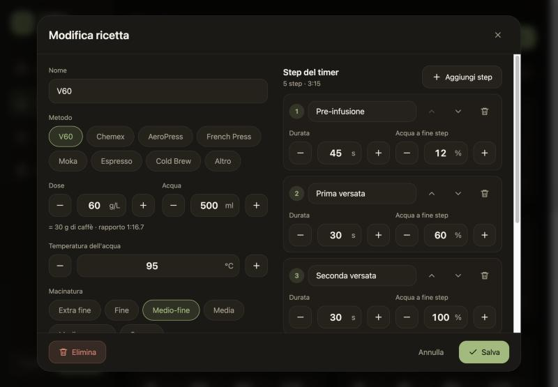
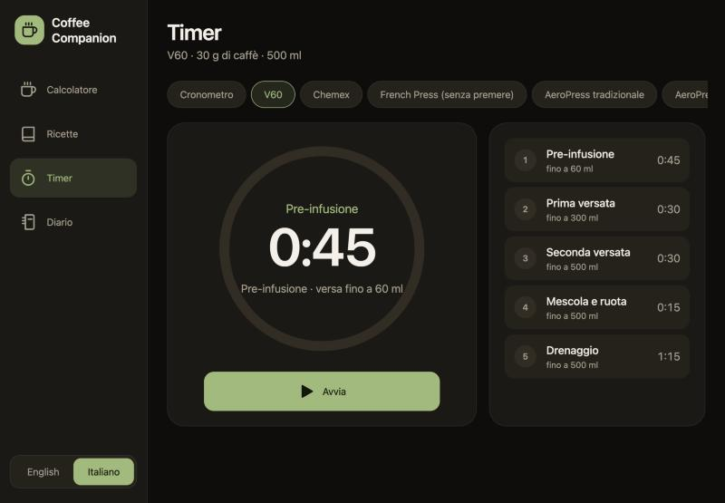
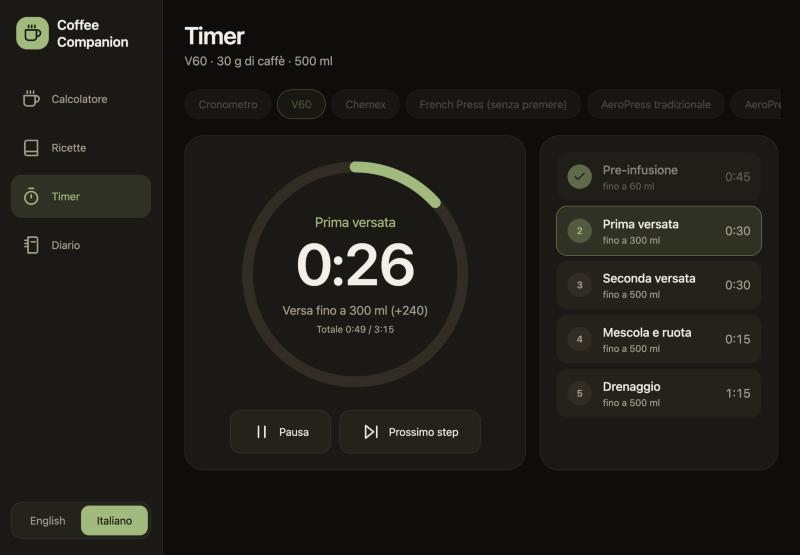
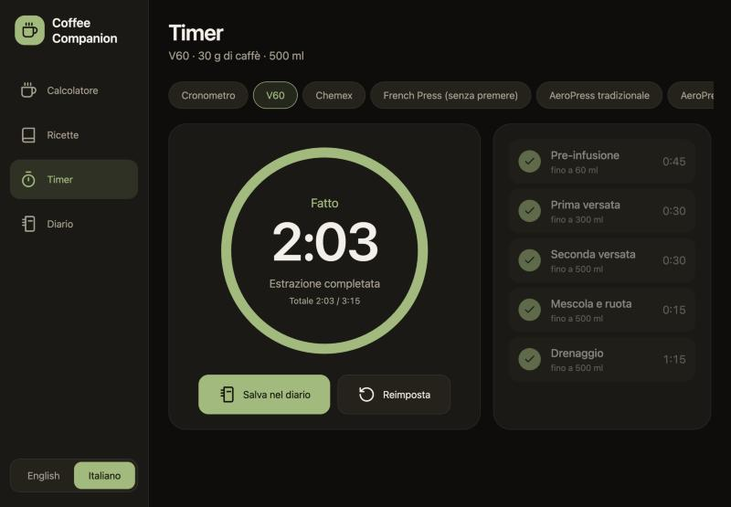
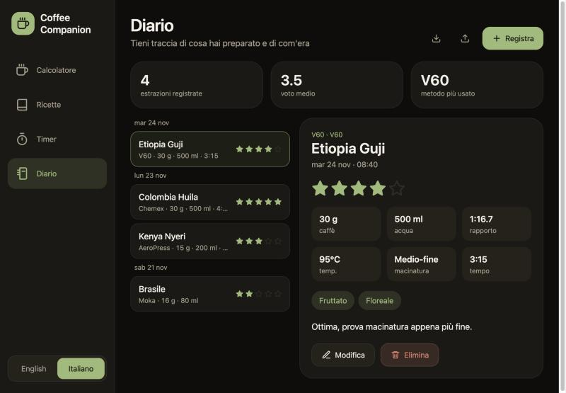
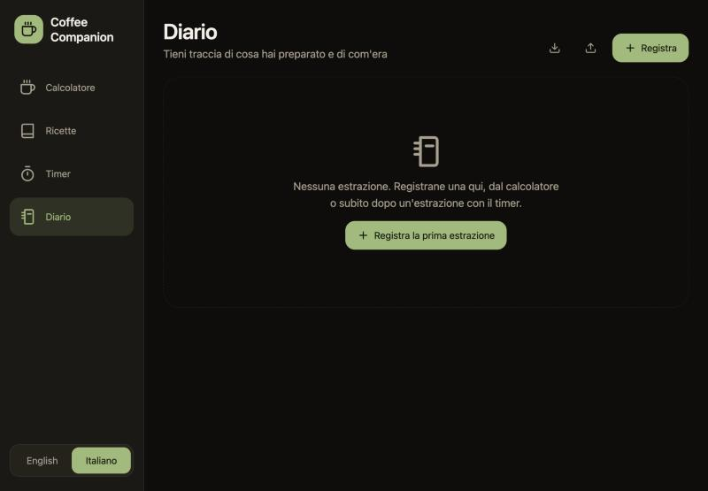

# Fase 1 — Analisi UI/UX attuale

Data: 24/11/2026 · Branch: `refresh/structure` · Viewport: iPad Air orizzontale (1180×820)

Contesto: app personale, solo iPad in orizzontale sul coffee corner. Si usa in due momenti diversi:

1. **Preparazione (da toccare):** metodo, dosi, ricetta, Play. Serve velocità e precisione.
2. **Estrazione (da guardare):** si segue il timer da lontano con le mani occupate, al massimo si mette in pausa. Servono leggibilità e zero interazioni.

Questa distinzione è il criterio principale dell'analisi.

Gli screenshot di riferimento ("prima") sono in [`baseline/`](baseline/).

---

## Prima impressione

L'app è pulita, coerente, scura e ordinata: non c'è niente di sbagliato a colpo d'occhio. Però **sembra un template**. Tutto è una card uguale alle altre e nessun elemento dice "caffè" oltre all'icona della tazza. Il verde salvia dell'accento richiama più il tè o il matcha che il caffè.

L'occhio va subito sul rapporto **1:16.7**, giusto, e sul bottone verde. Nel timer invece il dato più importante durante la versata (quanta acqua) è il testo meno visibile dello schermo.

---

## Punti forti (da tenere)

- **Touch generoso:** i bottoni vanno da 44 a 64 px, i campi +/− ripetono il valore tenendo premuto e gli slider hanno un cursore da 32 px.
- **Contrasto del testo buono:** il testo secondario fa 6,8:1 sulle card e l'accento 8,2:1 (il minimo WCAG AA è 4,5:1).
- **Coerenza:** gli stessi componenti (Chip, Card, Button, NumberField) sono usati ovunque e gli angoli sono già arrotondati (16–28 px), in linea con il tuo gusto.
- **Rapporto 1:N grande e centrale** nel calcolatore: è il dato più "parlante".
- **Lista degli step nel timer:** lo stato fatto / in corso / da fare è chiaro, con spunta, evidenziazione e ml di arrivo per ogni step.
- **Funzionalità solide:** suoni negli ultimi 3 secondi e al cambio step, schermo sempre acceso, timer preciso anche con lo schermo spento.
- **Diario in vista divisa:** lista a sinistra e dettaglio a destra, un buon uso dell'orizzontale.
- **Numeri tabulari:** le cifre non "ballano" mentre cambiano.

---

## Il problema principale: il flusso è spezzato in tre schermate

Il tuo flusso reale è **metodo → dosi → ricetta → Play**. Oggi richiede:

| Passo                | Dove                          | Tap                          |
| -------------------- | ----------------------------- | ---------------------------- |
| Scegli metodo e dosi | Calcolatore                   | 1 + regolazioni              |
| Scegli la ricetta    | **Ricette** (altra schermata) | 1 (cambia tab) + 1 (Prepara) |
| Avvia                | **Timer** (altra schermata)   | 1 (Avvia)                    |

Problemi:

- **Ordine invertito:** scegliere la ricetta _dopo_ le dosi le **sovrascrive** con quelle della ricetta. Nei fatti l'ordine è obbligato (ricetta → poi dosi), ma l'interfaccia suggerisce il contrario.
- **"Inizia l'estrazione" nel calcolatore non avvia niente:** porta al timer, dove serve un altro tap su "Avvia".
- **Il calcolatore non mostra quale ricetta è caricata.** Il timer mostra le ricette come chip, la schermata Ricette come card: sono tre modi diversi di scegliere la stessa cosa.

**Opportunità n. 1:** una schermata unica "Prepara" con ricetta (o metodo libero), dosi e Play, e il timer come stato successivo della stessa schermata. Le schermate Ricette e Diario restano per la gestione.

---

## Analisi per schermata

### 1. Calcolatore — 

| Problema                                                                                    | Gravità | Proposta                                                                               |
| ------------------------------------------------------------------------------------------- | ------- | -------------------------------------------------------------------------------------- |
| La ricetta non è scelta qui (vedi sopra)                                                    | 🔴      | Ricetta e metodo nello stesso selettore                                                |
| CTA "Inizia l'estrazione" che non avvia                                                     | 🟡      | Il Play avvia davvero                                                                  |
| Dose in **g/L**: concetto insolito; il rapporto, che è più intuitivo, non si può modificare | 🟡      | Il rapporto 1:N diventa un input diretto (o un selettore), la g/L resta come dettaglio |
| Etichette doppie: titolo card "Dose" + etichetta campo "Dose"                               | 🟢      | Una sola etichetta                                                                     |
| Tre card uguali per tre campi: input (caffè, acqua) e risultato non si distinguono          | 🟡      | Gerarchia: 2 valori principali grandi, il terzo derivato                               |
| "Acqua rapida" occupa una card intera per 5 chip                                            | 🟢      | Preset integrati nel campo acqua o come tazze (1, 2, caraffa)                          |
| Temperatura e macinatura in sola lettura, prese dal metodo e non dalla ricetta              | 🟡      | Mostrare quelle della ricetta scelta                                                   |
| Lo slider cambia scala da solo (`rangeMax`): il cursore "salta"                             | 🟢      | Range fisso per metodo o selettore a rotella / dial                                    |
| Metodo come fila di 8 chip uguali, senza icona né distinzione visiva                        | 🟢      | Selettore con icone dei metodi                                                         |

### 2. Ricette — 

| Problema                                                                            | Gravità | Proposta                                          |
| ----------------------------------------------------------------------------------- | ------- | ------------------------------------------------- |
| **Muro di verde:** 9 bottoni "Prepara" pieni nello stesso colore, nessuna gerarchia | 🟡      | Card intera toccabile, azione secondaria discreta |
| Titoli troncati ("French Press (senza preme…")                                      | 🟢      | Titolo su 2 righe o nome breve + variante         |
| 4 mini-box per card (caffè, acqua, temperatura, tempo): densi e tutti uguali        | 🟢      | 1–2 dati chiave e un'icona del metodo             |
| Filtri che escono dallo schermo senza un indizio di scroll                          | 🟢      | Sfumatura sul bordo o filtri compatti             |
| Preferiti solo come cuore, ordinati in cima ma non separati                         | 🟢      | Sezione "Preferite" o pin                         |

**Dettaglio ricetta** — 

- Le note sono un **muro di testo** di 10 righe: le informazioni utili (macinatura più fine, peso della pre-infusione) si perdono.
- Il metodo è ripetuto (titolo "V60" e sotto ancora "V60").
- Gli step finiscono sotto la piega, il valore "Medio-fine" va a capo e il modale è stretto (672 px) su uno schermo largo 1180.

**Editor ricetta** — 

- Form lungo e denso: ogni step ha 6 controlli.
- **L'acqua degli step in % cumulativa** è poco intuitiva: mentre versi pensi in ml o grammi.
- Manca un'anteprima della sequenza (timeline). Le chip della macinatura vengono tagliate dallo scroll.
- Nota: è una schermata usata di rado, quindi ha priorità bassa.

### 3. Timer — la schermata più importante

  

| Problema                                                                                                                       | Gravità | Proposta                                                                 |
| ------------------------------------------------------------------------------------------------------------------------------ | ------- | ------------------------------------------------------------------------ |
| **Durante la versata l'informazione chiave ("Versa fino a 300 ml (+240)") è testo piccolo e grigio**, mentre il tempo è enorme | 🔴      | Acqua target protagonista quanto il tempo, o di più                      |
| Le cifre sono alte ~87 px perché il quadrante è limitato al 44% dell'altezza: leggibili da vicino, deboli a 1–2 m              | 🔴      | Modalità "focus" a tutto schermo durante l'estrazione                    |
| Sidebar, titolo, sottotitolo e chip delle ricette restano visibili durante l'estrazione (le chip disabilitate al 40%)          | 🟡      | Nasconderli in modalità focus                                            |
| Nessun preavviso visivo del cambio step: solo i bip degli ultimi 3 s. Senza audio, da lontano, non te ne accorgi               | 🟡      | Cambio di colore o stato o animazione del quadrante negli ultimi secondi |
| L'anello mostra solo lo step corrente; il progresso totale è un testo piccolo ("Totale 0:49 / 3:15")                           | 🟢      | Doppio anello o timeline lineare degli step                              |
| **"Prossimo step" diventa "Termina" nello stesso punto** all'ultimo step: un doppio tap può chiudere l'estrazione per errore   | 🟡      | Posizioni diverse o pressione prolungata per terminare                   |
| Pausa e Prossimo hanno lo stesso stile secondario e sono piccoli rispetto all'uso con le mani occupate                         | 🟢      | Pausa = toccare il quadrante (area enorme)                               |
| La fine è piatta: "Fatto" e anello pieno                                                                                       | 🟢      | Momento di chiusura: animazione + riepilogo + "Salva nel diario"         |
| Ricaricare l'app (o se iPadOS la chiude) durante l'estrazione fa **perdere il timer**                                          | 🟡      | Salvare lo stato del timer e riprenderlo                                 |

### 4. Diario —  

Funziona bene ed è secondario rispetto al flusso principale.

- Testo troncato nella lista ("Chemex · 30 g · 500 ml · 4:…") e metodo duplicato nel dettaglio ("V60 · V60").
- Le statistiche (3 card grandi) occupano spazio per informazioni poco utili.
- Export e import sono icone senza etichetta accanto al titolo: azioni rare in posizione molto visibile.

---

## Aspetti trasversali

### Identità visiva e palette

- La palette è scuro caldo (`#0f0d0b` → `#322d24`) con accento verde salvia `#9dbb78`. È coerente ma poco "caffè" e poco memorabile.
- C'è un solo accento, usato per tutto: selezione, CTA, progresso, preferiti, stelle. Così perde forza.
- Esiste solo il tema scuro. Va deciso se serve anche un tema chiaro o automatico (il coffee corner di mattina, con luce naturale).

### Tipografia

- Si usa solo il font di sistema (SF Pro), con pesi 400 e 600.
- Non c'è una scala definita: compaiono 14 / 16 / 18 / 20 / 30 / 36 px più i numeri grandi, e il 16 px è usato per quasi tutto (190 elementi su 226).
- I numeri, che sono il cuore dell'app, non hanno un trattamento tipografico dedicato.

### Profondità e gerarchia

- **Ogni contenitore è la stessa card** (raggio 28, bordo bianco all'8%, sfondo `#1c1915`). Il bordo è quasi invisibile (~1,2:1), quindi le card si distinguono a fatica dallo sfondo e niente emerge.
- C'è un'ombra solo sui modali.

### Animazioni

- **Praticamente assenti:** ci sono solo la scala al tocco (`active:scale`) e i cambi di colore.
- Cambio schermata istantaneo, modali e toast che compaiono e spariscono di colpo, nessuna transizione tra gli stati del timer.
- L'anello avanza a scatti di 100 ms invece che in modo continuo.
- C'è ampio margine per animazioni "presenti ma non eccessive".

### Navigazione

- La sidebar fissa da 240 px ha 4 voci e il selettore di lingua, che si cambia raramente ma resta sempre visibile.
- Lo stato attivo (accento al 15%) è debole. Il colore di "premuto" è simile, quindi dopo un tocco a volte sembrano esserci due voci selezionate.
- L'app si apre sempre sul Calcolatore: va bene solo se diventa la schermata "Prepara".

### Selettori e input

| Controllo                | Stato                                                                   | Note                                                   |
| ------------------------ | ----------------------------------------------------------------------- | ------------------------------------------------------ |
| Chip                     | Buono, ma usato per tutto (metodi, filtri, ricette, macinatura, sapori) | Nessuna differenza tra scelta singola e multipla       |
| NumberField +/−          | Solido, tenere premuto funziona                                         | Pesante visivamente: 3 box per ogni valore             |
| Slider                   | Funzionale                                                              | Traccia sottile, scala che salta, ridondante con i +/− |
| Stelle                   | Vuote quasi invisibili (1,28:1)                                         |                                                        |
| Elimina con doppio tocco | Buono                                                                   |                                                        |
| Selettore lingua         | Segmentato, ok                                                          | Posizione troppo prominente                            |

### Accessibilità (iPad, uso personale)

| Elemento                              | Contrasto     | Esito                                            |
| ------------------------------------- | ------------- | ------------------------------------------------ |
| Testo principale su card              | 15,4:1        | ✅                                               |
| Testo secondario su card / superficie | 6,8:1 / 6,2:1 | ✅                                               |
| Accento su card                       | 8,2:1         | ✅                                               |
| Testo sul bottone primario            | 8,6:1         | ✅                                               |
| Stelle vuote                          | 1,28:1        | ❌ (servono almeno 3:1 per gli elementi grafici) |
| Bordi delle card                      | ~1,2:1        | ⚠️ decorativo, ma riduce la separazione          |

- Le dimensioni dei tocchi sono buone.
- La leggibilità a distanza dipende dal timer: vedi sopra.

---

## Opportunità in ordine di impatto

1. **Schermata "Prepara" unica** con ricetta/metodo, dosi e Play che avvia davvero, al posto di tre schermate.
2. **Modalità focus per l'estrazione:** a tutto schermo, con acqua target e tempo giganti, tocco ovunque per la pausa, preavviso visivo del cambio step e progresso totale visibile.
3. **Identità visiva:** palette più "caffè" con 2 accenti e ruoli chiari, font numerico dedicato, gerarchia con superfici diverse invece di card uguali.
4. **Animazioni con uno scopo:** transizione tra preparazione ed estrazione, anello continuo, cambio step, chiusura dell'estrazione, apertura dei modali, feedback dei controlli.
5. **Selettori dedicati:** metodi con icone, rapporto modificabile, preset di acqua integrati, input numerici più leggeri.
6. **Ricette più leggibili:** card meno dense, note strutturate (punti chiave invece del paragrafo), acqua degli step in ml.
7. **Rifiniture:** testi troncati e duplicati, stelle, posizione della lingua e dell'export/import, ripresa del timer dopo un riavvio.

---

## Temi da decidere in fase 2 (brainstorming)

Per ognuno ti proporrò almeno 4 opzioni:

1. Struttura e navigazione (schermata Prepara, sidebar, modalità focus)
2. Palette colori e tema (scuro / chiaro / automatico)
3. Tipografia (testo e numeri)
4. Superfici, forme e profondità (card, raggi, ombre, vetro)
5. Selettore ricetta/metodo
6. Input di dosi e rapporto (stepper, slider, dial, rotella)
7. Design del timer (quadrante, numeri, acqua target, progresso)
8. Animazioni e micro-interazioni (stile, intensità, momenti chiave)
9. Bottoni e stati (primario/secondario, premuto, disabilitato)
10. Icone (metodi, navigazione, icona dell'app)
11. Schermate secondarie (Ricette, Diario, editor)
12. Suoni e feedback (cue sonori/visivi)
